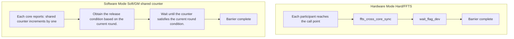

# SYNCALL

<!-- md-trans-meta sourceCommit=unknown translatedAt=2026-10-30T04:23:27.880Z pushedAt=2026-11-02T03:00:52.152Z nl=2 -->

## Instruction Diagram

> The repository does not provide `SYNCALL.svg`. `SYNCALL` is a **cross-core control plane** primitive that does not describe data transformation on a single tile. Its semantics are "all participants converge at the same point and then proceed."




## Introduction

`SYNCALL` is a cross-core synchronization barrier. The two template parameters are independent of each other:

- `SyncCoreType` selects the participant set: **AIVOnly** (default), **AICOnly**, **Mix** (AIC+AIV).
- `SyncAllMode` selects the implementation path: **Hard** (FFTS hardware flag, no workspace overload) and **Soft** (GM shared atomic counter, with workspace overload).


## Mathematical Semantics

Element-wise arithmetic semantics do not apply; instead, it expresses a **barrier arrival** relationship: only after every core in the current participant set has executed this `SYNCALL` can any core proceed. Hard and Soft have exactly the same semantics, differing only in the implementation path.

## C++ Built-in APIs

The public header is `<pto/pto-inst.hpp>`, and the declaration is located in `include/pto/common/pto_instr.hpp`:

```cpp
// Hardware mode (common to all CoreTypes).
template <SyncCoreType CoreType = SyncCoreType::AIVOnly>
PTO_INST void SYNCALL();

// Software mode: GM shared atomic counter.
template <SyncAllMode Mode, SyncCoreType CoreType = SyncCoreType::AIVOnly, typename GlobalData,
          std::enable_if_t<is_global_data_v<GlobalData>, int> = 0>
PTO_INST void SYNCALL(GlobalData &gmWorkspace, int32_t usedCores = 0);
```


## Parameters

- `gmWorkspace`: a GM buffer used in Soft mode, of type `GlobalTensor<int32_t, pto::Shape<>, pto::Stride<>>`. The instruction uses only its **first int32** as the arrival counter shared by all participants, so allocating one cache line is sufficient, and it **must be cleared to zero before first use**.
- `usedCores`: the number of cores participating in synchronization.
  - When it is 0, the instruction infers it automatically: AIV-only and AIC-only take the number of cores in this launch; MIX takes the sum of all AIC cores and their paired AIV cores.
  - When explicitly specified, it **may be less than the launch core count**, meaning only some cores participate in synchronization; in this case, the non-participating cores **must not** call `SYNCALL`.

When `Mode` is `Hard`, `gmWorkspace` and `usedCores` are ignored, and the behavior is equivalent to `SYNCALL()` without arguments.

## Constraints

- `SYNCALL` only guarantees the barrier **arrival** itself. The ordering and visibility of business data are the caller's responsibility: it does not participate in PTO's automatic Event dependency scheduling (it accepts no `WaitEvents` and returns no `RecordEvent`), it does not wait for preceding data instructions on the current core (such as `TSTORE`) to complete, and neither hard nor soft mode **flushes the business data cache**. Cross-core GM reads and writes around the barrier require explicit `dcci` / `dsb`.
- Soft mode requires all participating cores to enter the same group of barriers in the **same order and the same number of times**. The instruction infers the current round from the arrival count; if a core enters one more or one fewer time, it will be out of phase with the other cores and eventually hang.
- The participant set is determined by how the kernel is compiled and launched, not by `SYNCALL`. The template parameter only declares "which type of core is to be synchronized this time"; how many cores are actually launched and how AIC and AIV are paired depend on which arch the kernel is compiled into and how it is launched. If the two do not match, some cores will wait forever.
- Hard AIC-only on A2/A3 cannot be compiled into a pure cube kernel: a pure `dav-c220-cube` cannot establish the FFTS context required for AIC-only hard synchronization, and it hangs in practice. It must be compiled as MIX (`dav-c220`), with the AIC side calling `SYNCALL<AICOnly>()` and the AIV side left empty. On A5, `dav-c310-cube` is sufficient.
- When compiling a kernel manually (without chevron automatic splitting), you must declare the kernel meta yourself; otherwise the runtime schedules it with the wrong core type, and hard synchronization cannot obtain the FFTS context and hangs. The meta is declared with the macros in `include/pto/common/kernel_meta.hpp` (`PTO_SYNCALL_AIV_KERNEL_META` / `PTO_SYNCALL_AIC_KERNEL_META` / `PTO_SYNCALL_MIX_AIC_KERNEL_META`), and the macro arguments must exactly match the `__global__` entry symbol. Currently only Hard AIV-only and Soft AIC-only on A2/A3 need to be written manually; the remaining scenarios are generated by the compiler.
- Under the auto build path (`__PTO_AUTO__`), `SYNCALL` is a no-op, and real synchronization occurs only in manual kernels.
- In CPU_SIM, all `SYNCALL` overloads are currently compatibility no-ops (including Soft mode) and do not synchronize the worker threads launched by `LaunchKernelMultiCore`.


## Examples


### Hardware Mode

```cpp
#include <pto/pto-inst.hpp>

using namespace pto;

void example_hard_aiv() { SYNCALL(); }                        // All AIV cores.
void example_hard_aic() { SYNCALL<SyncCoreType::AICOnly>(); } // All AIC cores.
void example_hard_mix() { SYNCALL<SyncCoreType::Mix>(); }     // AIC+AIV
```

For compilation and launch requirements, see "Constraints".

### Software Mode

```cpp
#include <pto/pto-inst.hpp>

using namespace pto;

// AIV-only: usedCores=0 automatically takes get_block_num().
void example_soft_aiv(__gm__ int32_t *gmPtr) {
  GlobalTensor<int32_t, pto::Shape<>, pto::Stride<>> gmWs(gmPtr);
  SYNCALL<SyncAllMode::Soft, SyncCoreType::AIVOnly>(gmWs, 0);
}

// MIX: AIC and AIV participants arrive at the same counter.
void example_soft_mix(__gm__ int32_t *gmPtr) {
  GlobalTensor<int32_t, pto::Shape<>, pto::Stride<>> gmWs(gmPtr);
  SYNCALL<SyncAllMode::Soft, SyncCoreType::Mix>(gmWs, 0);
}

// Partial core participation: launch all cores, only the first syncBlocks cores synchronize, and the remaining cores must not call SYNCALL.
void example_soft_partial(__gm__ int32_t *gmPtr, int32_t syncBlocks) {
  if (static_cast<int32_t>(get_block_idx()) >= syncBlocks) {
    return;
  }
  GlobalTensor<int32_t, pto::Shape<>, pto::Stride<>> gmWs(gmPtr);
  SYNCALL<SyncAllMode::Soft, SyncCoreType::AIVOnly>(gmWs, syncBlocks);
}
```
