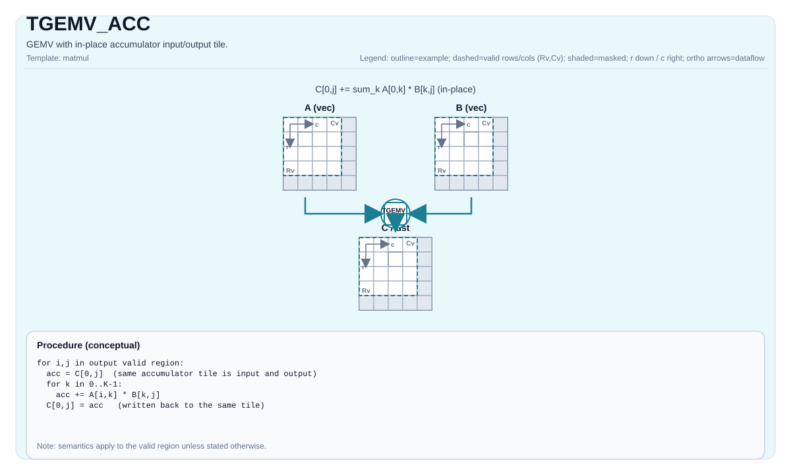

# TGEMV_ACC

<!-- md-trans-meta sourceCommit=unknown translatedAt=2026-10-30T05:02:28.254Z pushedAt=2026-11-02T03:00:52.185Z nl=2 -->

## Instruction Diagram



## Introduction

GEMV with an explicit accumulator input tile (`cInMatrix`) and output tile (`cOutMatrix`).

## See Also

- Basic GEMV instruction: `docs/isa/TGEMV.md`.
- Bias variant: `docs/isa/TGEMV_BIAS.md`.

## C++ Built-in APIs

Declared in `include/pto/common/pto_instr.hpp`:
> The public include header is `<pto/pto-inst.hpp>`, and the internal declaration is located in `pto/common/pto_instr.hpp`.

```cpp
template <typename TileRes, typename TileLeft, typename TileRight, typename... WaitEvents>
PTO_INST RecordEvent TGEMV_ACC(TileRes &cOutMatrix, TileRes &cInMatrix, TileLeft &aMatrix, TileRight &bMatrix, WaitEvents &... events);

template <AccPhase Phase, typename TileRes, typename TileLeft, typename TileRight, typename... WaitEvents>
PTO_INST RecordEvent TGEMV_ACC(TileRes &cOutMatrix, TileRes &cInMatrix, TileLeft &aMatrix, TileRight &bMatrix, WaitEvents &... events);
```

## Mathematical Semantics

Assume:

- `M = 1`
- `K = bMatrix.GetValidRow()`
- `N = bMatrix.GetValidCol()`

For `0 <= j < N` (accumulate into the existing output tile):

$$ \mathrm{C}_{0,j} \gets \mathrm{C}_{0,j} + \sum_{k=0}^{K-1} \mathrm{A}_{0,k} \cdot \mathrm{B}_{k,j} $$

The existing `C` element is the initial accumulation value of the fused multiply-add sequence, rather than first computing the dot product independently from zero and then adding `C` at the end; when accumulating across K tiles, the two orders may produce different floating-point rounding results. Data type promotion is still target/implementation-defined.

## Constraints

### General Shape and Position Constraints

- Static shape constraints:
    - `TileLeft::Rows == TileRes::Rows`
    - `TileLeft::Cols == TileRight::Rows`
    - `TileRight::Cols == TileRes::Cols`
- Tile position constraints:
    - `TileLeft::Loc == Left`
    - `TileRight::Loc == Right`
    - `TileRes::Loc == Acc`
- Runtime valid size constraints:
    - `m` must be `1`
    - `k` and `n` (obtained from `bMatrix.GetValidRow()` and `bMatrix.GetValidCol()`) must be within `[1, 4095]`
- The Acc stride constraints of `TMATMUL` also apply.

### Data Type Constraints

- **Implementation check (Atlas A2/A3 training products/Atlas A2/A3 inference products)**:
    - Supported `(CType, AType, BType)` triples:
        - `(int32_t, int8_t, int8_t)`
        - `(float, half, half)`
        - `(float, float, float)`
        - `(float, bfloat16_t, bfloat16_t)`
- **Implementation check (Ascend 950PR/Ascend 950DT)**:
    - The accumulator type must be `int32_t` or `float`.
    - If it is `int32_t`: `AType == int8_t` and `BType == int8_t`.
    - If it is `float`: supports `half`, `bfloat16_t`, `float`, selected fp8 combinations, and `hifloat8_t/hifloat8_t` (target-defined).
    - The following fractal/layout constraints are enforced:
        - Left: `Loc == Left`, `!isRowMajor`, `SFractal == RowMajor`
        - Right: `Loc == Right`, `isRowMajor`, `SFractal == ColMajor`
        - Acc: `Loc == Acc`, `!isRowMajor`, `SFractal == RowMajor`
    - In addition to the GEMV conventions above, the underlying Ascend 950PR/Ascend 950DT matmul implementation does not add a separate set of explicit `m/k/n` runtime assertions.

## Examples

### Automatic

```cpp
#include <pto/pto-inst.hpp>

using namespace pto;

void example_auto() {
  using A = TileLeft<half, 1, 16>;
  using B = TileRight<half, 16, 16>;
  using C = TileAcc<float, 1, 16>;
  A a;
  B b;
  C c0, c1;
  TGEMV_ACC(c1, c0, a, b);
}
```

### Manual

```cpp
#include <pto/pto-inst.hpp>

using namespace pto;

void example_manual() {
  using A = TileLeft<half, 1, 16>;
  using B = TileRight<half, 16, 16>;
  using C = TileAcc<float, 1, 16>;
  A a;
  B b;
  C c0, c1;
  TASSIGN(a, 0x1000);
  TASSIGN(b, 0x2000);
  TASSIGN(c0, 0x3000);
  TASSIGN(c1, 0x4000);
  TGEMV_ACC(c1, c0, a, b);
}
```
